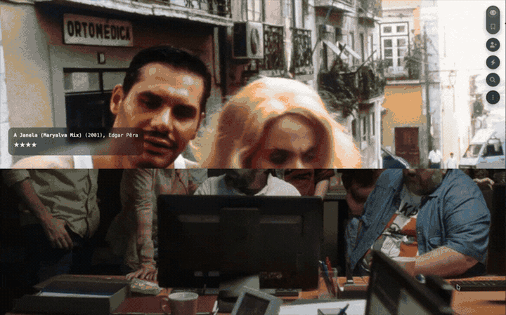

# have i seen it? (or should we watch it?)

**A cinematic way to browse my Letterboxd diary — and find the overlap between my watchlist and someone else’s.**

See it running at [ritapatacas.github.io/haveiseenit](https://ritapatacas.github.io/haveiseenit/)

<p align="center">
  
</p>

## Why

Letterboxd is great for logging films, but slower when I want to answer “have I seen this?” or find something to watch with someone else. This project turns my diary and watchlist into a visual, searchable space, then makes the shared-watchlist question a single username away.

## What it does

| Mode | Browse |
| --- | --- |
| **Have I seen it?** | My logged films, with ratings and reviews where available. |
| **Should I watch it?** | My watchlist. |
| **Should we watch it?** | Enter any Letterboxd username to find films on both watchlists. Yeah, I know Letterboxd already lets you make a shared watchlist — this is my quick way to find the overlap. |

Search the active list as you type, pick a random film with the button or `Space`, and find keyboard shortcuts in the in-app help.



*Full view gives each film its moment, with artwork and diary details.*


*Slot view turns the list into a poster wall for quick scanning.*


*A search miss answers the question directly and links to Letterboxd.*


*Enter a username to surface films on both watchlists.*

## Design decisions
| Decision | Why |
| --- | --- |
| Two views: **Full** (one film at a time, with backdrops) and **Slot** (a poster grid with 2–11 columns depending on viewport width) | Full gives each film room; Slot makes a long list easier to scan. |
| Search misses use plain language (“Have I seen X? no. (did I?)”) and link to Letterboxd search | Keep the original question in view and offer a next step. |
| One compact icon menu; search and username inputs open inline | Keep browsing in context without opening dialogs. |
| Mobile views limit the initial display to 40 entries | Keep scrolling smooth on smaller screens; searching still checks the full loaded list. |
| Random pick is a first-class action, available as a button and a keyboard shortcut | Make choosing the next film part of the browsing experience. |

## Tech stack

Vanilla JavaScript and CSS, with no framework or build step; a Node.js 20 server using plain `http`; Letterboxd watchlist scraping with a five-minute API cache; Google Sheets CSV exports as the film data source; and TMDB-hosted images for posters and backdrops.

## Run locally

Requires Node.js 20. Run `npm start`, then open [http://localhost:8080](http://localhost:8080). The app opens on my logged films; no username is needed unless you choose **Should we watch it?**.

### API

`GET /api/watchlist?user=<username>` returns film URIs for a Letterboxd user's watchlist. Results are cached for five minutes.

Fetch watchlist data from the command line:

```bash
node server/fetch_letterboxd_user_watchlist.js <username> --pages 5 --out watchlist.json
```

## Project structure

```text
app/
  scripts/
    common/       # Shared data, UI, constants, copy, and TMDB image helpers
    view/
      full/       # One-film-at-a-time view
      slot/       # Responsive poster grid
  styles/         # Shared and view-specific CSS
docs/             # README demo GIFs
server/
  server.js                           # HTTP API and static file server
  fetch_letterboxd_user_watchlist.js  # Letterboxd watchlist scraper and CLI
index.html
Dockerfile
fly.toml
```

Deployment: Fly.io via `Dockerfile`/`fly.toml` and GitHub Pages.

## What I’d do next

Suggestions for me to confirm:

- Let visitors load and browse their own logged films.
- Use a sturdier data source than HTML scraping.
- Add shareable links for watchlist matches.

Made by [Rita Patacas](https://github.com/ritapatacas).
